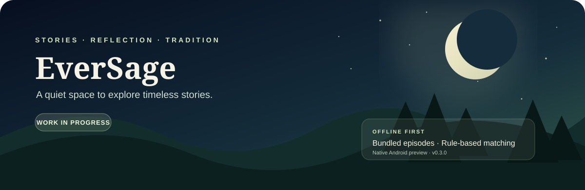

<div align="center">



### A quiet space to explore timeless stories

A native Android prototype for exploring short episodes and reflections from traditional story collections, designed to work offline.

[Experience](#-the-current-preview) · [Project Structure](#-repository-guide) · [Build](#-build-locally) · [Roadmap](#-roadmap)


</div>

---

## 🌿 The current preview

EverSage is an early native Android build that keeps its episode data bundled with the app. It uses rule-based offline matching to suggest an episode rather than calling a generative AI service.

| Detail | Current scope |
|---|---|
| **Preview version** | 0.3.0 |
| **Platform** | Native Android Views |
| **Content bundle** | 57 episodes across 23 tradition groups |
| **Minimum Android** | Android 8.0 / API 26 |
| **Build target** | Android SDK 35 |
| **Network dependency for matching** | None; matching runs against bundled data |

Coverage is still limited. Some traditions and situations will not have a close match, and this prototype should not be treated as an exhaustive scripture or cultural reference library.

## 🗂 Repository guide

| Path | Purpose |
|---|---|
| `app/` | Native Android Java source, manifest, resources, artwork, and bundled episode data |
| `apk/` | Existing signed preview APK and supporting reports |
| `artwork/` and `branding/` | Artwork masters and approved branding assets |
| `design-reference/` | UI concept images; not every pictured detail is implemented |
| `knowledge/episodes/` | Readable episode text grouped by tradition |
| `legacy/` | Earlier web implementation and text, retained for reference only |
| `tools/` | Content preparation scripts |

## 🛠 Build locally

**Requirements**
- Android Studio
- Android SDK 35
- JDK 17, or a compatible JDK bundled with Android Studio
- Gradle 8.9 installed separately for the command-line option

### Android Studio

1. Clone or download the repository.
2. Open the repository root in Android Studio.
3. Let Gradle sync finish.
4. Choose **Build APK(s)** from the Build menu.

### Command line

```bash
gradle :app:assembleDebug
```

A Gradle wrapper is not bundled. Locally built APKs use your local debug signing key. If a signature conflict appears when installing over the supplied preview APK, uninstall the old preview first.

## 🔍 Validation notes

The included preview was reported to have passed compilation, signature, archive, and seven classifier checks when prepared. It has **not yet been runtime-tested on a phone or emulator**, and the Gradle project layout has not been independently built with the documented command in this workspace. The concept artwork may also show UI details not present in the current implementation.

## 🗺 Roadmap

- [ ] Run the app on physical Android devices and emulator configurations.
- [ ] Improve offline matching for themes, traditions, and user situations.
- [ ] Expand and review the episode library with transparent source references.
- [ ] Bring the implemented UI closer to the design references.
- [ ] Add tests for matching, empty results, and missing or invalid data.
- [ ] Review accessibility, text scaling, and navigation behavior.
- [ ] Complete edition-specific source-rights review before public or commercial distribution.

## 📚 Content and usage notes

Episode texts include source references and retellings. EverSage does not claim exhaustive coverage of any scripture or tradition, and inclusion does not guarantee that every source is cleared for commercial use. Review translations, editions, and applicable rights before distribution.

Signing keys, credentials, SDKs, caches, original PDFs, and conversation exports are intentionally excluded.

## 👤 Author

**Anudeep Paladugu** · [GitHub](https://github.com/AnudeepPaladugu) · [LinkedIn](https://www.linkedin.com/in/anudeeppaladugu/)
